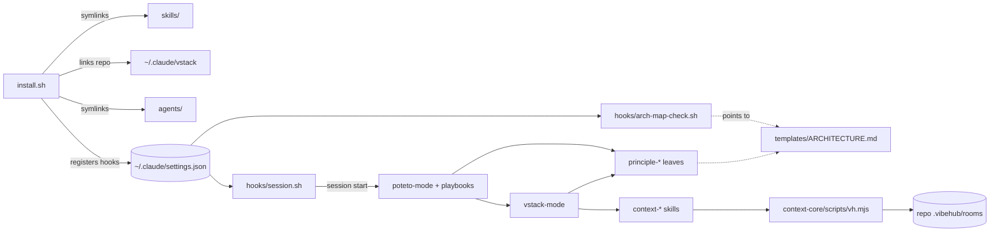

# Architecture: vstack

> Last verified against code: 2026-11-22 (pstack fork, phase 1 of #21)

## Purpose

Victor's agent skills for Claude Code, including a fork of pstack (cursor/plugins@bf0c7cd, MIT, listed in NOTICE.md). Each session loads the forked poteto-mode, then vstack-mode. vstack-mode adds Victor's principles and process sizing, and wins where the two conflict. The context-* skills are Victor's project context layer: decisions, constraints, and docs recorded as Git-tracked Rooms under each repo's `.vibehub/`.

## Diagram

## Components

| Name | Path | Owns | Level | Why this level | Room |
|---|---|---|---|---|---|
| poteto-mode (fork) | skills/poteto-mode and the other skills in NOTICE.md | base workflow, playbooks, pstack principles | module | — | — |
| agents (fork) | agents/ | poteto-agent and comment-sicko subagents | module | — | — |
| session hook | hooks/session.sh, hooks/session.md | host mappings, turning both modes on | module | — | — |
| vstack-mode | skills/vstack-mode | ownership rule, process sizing, principle index | module | — | — |
| principles | skills/principle-* | one rule each, read on trigger | module | — | — |
| housekeep | skills/housekeep | `/housekeep` branch-health command | module | — | — |
| arch-map-check | hooks/arch-map-check.sh | blocking commits that reshape a repo without a map update | module | — | — |
| templates | templates/ | ARCHITECTURE.md skeleton | module | — | — |
| context layer | skills/context-* | recording and reading project context in `.vibehub/rooms/` | module | — | — |
| installer | install.sh | symlinks, hook registration, retiring an old pstack install | module | — | — |

## Key flows

- **Session start:** `hooks/session.sh session` injects `hooks/session.md` → agent reads poteto-mode → agent reads vstack-mode → principles read on trigger.
- **Merge:** merge cleanup → agent lists context candidates → Victor confirms → context-record → `vh context put` → `.vibehub/rooms/<room>/` committed.
- **Design complaint:** Victor calls a UI ugly or AI-ish (in any repo) → agent appends to `skills/principle-design-floor/log.md` in vstack → a repeat with no floor line becomes a merge-time candidate → Victor confirms → the line joins the floor table.
- **Agent commit:** Claude Code PreToolUse → arch-map-check.sh → exit 2 with a message if the structure changed without ARCHITECTURE.md.

## Boundaries and invariants

- The forked skills keep pstack's MIT license and notice (`LICENSES/pstack-MIT.txt`, `NOTICE.md`). Nothing syncs from upstream. Changes worth taking come in as proposed issues (#21 phase 5).
- `install.sh` never deletes. It moves anything it replaces into `~/.claude/vstack-backup/<time>/`.
- `install.sh` is idempotent. Rerunning it adds nothing twice.
- In repos Victor doesn't own, the hook does nothing and the project's own conventions win.
- The context layer never loads or writes VibeHub Tickets, Goals, Epics, Evidence, or Outcomes; their files in a repo stay untouched.
- arch-map-check ignores `.vibehub/`, so recording context never counts as a structural change.

## External dependencies

| Name | Used by | Adapter |
|---|---|---|
| Claude Code hooks | arch-map-check | `~/.claude/settings.json` |
| GitHub via `gh` | housekeep, proposals-become-issues | `gh` CLI |
| Node.js | context layer | `node` runs `vh.mjs`, no packages |
| victor-ui MCP | principle-ui-from-victor-ui | user-scope HTTP server `victor-ui` in `~/.claude.json`; access code never in this repo |
