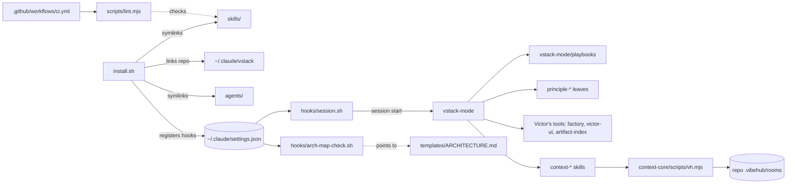

# Architecture: vstack

> Last verified against code: 2026-11-27 (lint and CI added)

## Purpose

Victor's agent skills for Claude Code. It began as a fork of pstack (cursor/plugins@bf0c7cd, MIT, listed in NOTICE.md) and is now one rulebook: each session loads `vstack-mode` and nothing else. `vstack-mode` holds the process rules, the index of principles, playbooks, and skills, and the list of Victor's own tools to reach for first. The context-* skills are Victor's project context layer: decisions, constraints, and docs recorded as Git-tracked Rooms under each repo's `.vibehub/`.

## Diagram

## Components

| Name | Path | Owns | Level | Why this level | Room |
|---|---|---|---|---|---|
| vstack-mode | skills/vstack-mode | the one rulebook: process sizing, when to ask, the index, Victor's tools | module | — | — |
| playbooks | skills/vstack-mode/playbooks, scripts | step lists for large tasks and their helper scripts | module | — | — |
| principles | skills/principle-* | one rule each, read on trigger | module | — | — |
| workflow skills | skills/architect, how, why, interrogate, and the rest | one job each, read on trigger | module | — | — |
| agents | agents/ | vstack-agent and comment-sicko subagents | module | — | — |
| session hook | hooks/session.sh, hooks/session.md | turning vstack-mode on | module | — | — |
| housekeep | skills/housekeep | `/housekeep` branch-health command | module | — | — |
| automate-me | skills/automate-me | mining sessions and proposing rule changes as issues | module | — | — |
| arch-map-check | hooks/arch-map-check.sh | blocking commits that reshape a repo with a map and leave the map alone | module | — | — |
| templates | templates/ | ARCHITECTURE.md skeleton, issue templates | module | — | — |
| context layer | skills/context-* | recording and reading project context in `.vibehub/rooms/` | module | — | — |
| lint | scripts/lint.mjs | failing on references, frontmatter, the mode's line budget, NOTICE, and the session hook | module | — | — |
| CI | .github/workflows/ci.yml | running the lint and the script tests on every PR | module | — | — |
| installer | install.sh | symlinks, stale-link cleanup, hook registration | module | — | — |

## Key flows

- **Session start:** `hooks/session.sh session` injects `hooks/session.md` → agent reads vstack-mode → principles, playbooks, and skills read on trigger.
- **Merge:** merge cleanup → agent lists context candidates → Victor confirms → context-record → `vh context put` → `.vibehub/rooms/<room>/` committed.
- **Design complaint:** Victor calls a UI ugly or AI-ish (in any repo) → agent appends to `skills/principle-design-floor/log.md` in vstack → a repeat with no floor line becomes a merge-time candidate → Victor confirms → the line joins the floor table.
- **Unattended run:** show-me-your-work → `log.sh <task-slug>` → `.vibehub/runs/<date>-<task-slug>.tsv`, committed with the work → `vh context page` shows the ten newest → Victor confirms what was settled → context-record.
- **Learning:** Victor runs automate-me → it mines `~/.claude/projects` → at most three `proposed` issues, each a code change, a check, or a prose rule, in the repo the change goes in → Victor approves → it lands.
- **Pull request:** CI runs `node scripts/lint.mjs`, the playbook script tests, and the context layer test. A red check blocks the merge.
- **Agent commit:** Claude Code PreToolUse → arch-map-check.sh → exit 2 with a message if the repo has an ARCHITECTURE.md and the structure changed without it.

## Boundaries and invariants

- Skills that came from pstack keep its MIT license and notice (`LICENSES/pstack-MIT.txt`, `NOTICE.md`). Nothing syncs from upstream.
- One mode. No file tells an agent to read a second rulebook or to resolve conflicts between two.
- A decision lives in one file. New rules go into the file that already covers the topic before a new file is added.
- `install.sh` never deletes a real file. It moves anything it replaces into `~/.claude/vstack-backup/<time>/`, and removes only its own dangling links.
- `install.sh` is idempotent. Rerunning it adds nothing twice.
- In repos Victor doesn't own, and in his repos without an ARCHITECTURE.md, the hook does nothing.
- The context layer never loads or writes VibeHub Tickets, Goals, Epics, Evidence, or Outcomes; their files in a repo stay untouched.
- A rule that a script can check lives in `scripts/lint.mjs`, not only in prose. Each lint failure names the fix.
- arch-map-check ignores `.vibehub/`, so recording context never counts as a structural change.

## External dependencies

| Name | Used by | Adapter |
|---|---|---|
| Claude Code hooks | session hook, arch-map-check | `~/.claude/settings.json` |
| GitHub via `gh` | housekeep, proposals-become-issues, automate-me | `gh` CLI |
| Node.js | context layer, playbook scripts | `node`, no packages for `vh.mjs` |
| victor-ui MCP | principle-ui-from-victor-ui | user-scope HTTP server `victor-ui` in `~/.claude.json`; access code never in this repo |
| tool factory | vstack-mode, principle-build-the-lever | `factory` CLI on PATH; the `writing-style` skill arrives through `factory link writing-style --global` |
| artifact-index MCP | vstack-mode | user-scope HTTP server `artifact-index` in `~/.claude.json`; access code never in this repo |
