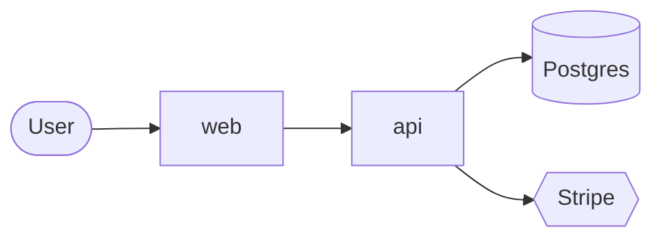

# Architecture: <project>

> Last verified against code: YYYY-MM-DD (commit <sha>)

## Purpose

Two or three sentences: what the system does and for whom.

## Diagram

## Components

| Name | Path | Owns | Level | Why this level |
|---|---|---|---|---|
| api | src/api | orders, users | module | — |
| worker | services/worker | background jobs | service | scales independently |

Level is module, package, or service. A module needs no reason. A package or service names its reason (principle-grow-boundaries-on-demand).

## Key flows

- **Checkout:** web → api `/orders` → db → worker → email.

## Boundaries and invariants

- web reaches data only through api's public surface.
- External input enters only at api handlers and is validated there.

## External dependencies

| Name | Used by | Adapter |
|---|---|---|
| Postgres | api | src/api/db.ts |
